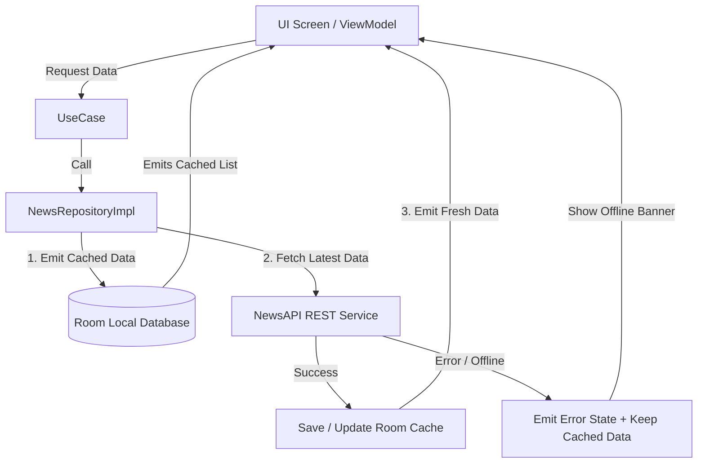

# Zuverlässige Nachrichten (News App)

A modern, production-ready native Android news application built with **Jetpack Compose**, **Clean Architecture**, **MVVM**, and **Room Database** following an **Offline-First** strategy. Data is powered by the [NewsAPI.org](https://newsapi.org) REST API.

---

## Features & User Stories

| # | User Story | Description | Status |
|---|---|---|:---:|
| 1 | **Categories Screen** | Displays 7 news categories (*Business, Entertainment, General, Health, Science, Sports, Technology*) with interactive Material 3 cards. | ✅ Done |
| 2 | **News Sources Screen** | Displays news sources filtered by category, showing language, country, and source details. | ✅ Done |
| 3 | **News Articles Screen** | Renders news articles for selected source with rich thumbnails, author, and publication timestamp. | ✅ Done |
| 4 | **Article Detail (WebView)** | Shows full article content in an embedded Android WebView with Share and Open-in-Browser actions. | ✅ Done |
| 5 | **Search Sources & Articles** | Real-time search functionality with 300ms debouncing for news sources and articles. | ✅ Done |
| 6 | **Endless Scrolling (Paging)** | Page-based pagination with infinite load triggered when scrolling near the end of the list. | ✅ Done |
| 7 | **Positive & Negative Handling** | Covers offline caching, error banners with retry mechanisms, empty states, and loading indicators. | ✅ Done |

---

## Architecture Overview

The app strictly follows **Clean Architecture** and **MVVM (Model-View-ViewModel)** design patterns:

```text
com.nachrichten.assessment/
├── data/                                # Data Layer (Retrofit API + Room Local DB)
│   ├── local/
│   │   ├── dao/                         # SourceDao & ArticleDao (Room DAOs)
│   │   ├── database/                    # NewsDatabase (Room DB)
│   │   └── entity/                      # SourceEntity & ArticleEntity (Local Caching)
│   ├── remote/
│   │   ├── api/                         # NewsApiService (Retrofit REST Interface)
│   │   └── dto/                         # Data Transfer Objects (DTOs & Mappers)
│   └── repository/
│       └── NewsRepositoryImpl.kt        # Offline-First Data Strategy Implementation
├── domain/                              # Domain Layer (Pure Kotlin Business Logic)
│   ├── model/                           # Domain Models (Category, Source, Article)
│   ├── repository/                      # NewsRepository Interface Definition
│   └── usecase/                         # Business Use Cases
│       ├── GetCategoriesUseCase.kt
│       ├── GetSourcesUseCase.kt
│       ├── SearchSourcesUseCase.kt
│       ├── GetArticlesUseCase.kt
│       └── SearchArticlesUseCase.kt
├── presentation/                        # Presentation Layer (MVVM + Jetpack Compose)
│   ├── navigation/                      # Screen Routes & NavGraph Setup
│   ├── categories/                      # Categories Screen & CategoriesViewModel
│   ├── sources/                         # Sources Screen & SourcesViewModel
│   ├── articles/                        # Articles Screen & ArticlesViewModel
│   ├── detail/                          # Article Detail WebView Screen
│   └── components/                      # Reusable UI (LoadingView, ErrorView, EmptyView, SearchBar)
├── di/                                  # Dependency Injection Layer
│   └── AppContainer.kt                  # AppContainer for Thread-Safe Manual DI
├── util/                                # Utilities
│   ├── Constants.kt                     # API Key & Config Constants
│   └── Resource.kt                      # Generic Result State Wrapper (Success, Error, Loading)
└── NewsApplication.kt                   # Application Entry Point
```

---

## Offline-First Strategy & Cache Policy

The application uses an **Offline-First** caching mechanism powered by **Room Database**:



1. **Fast Local Display**: When a screen loads, local Room DB data is emitted immediately to give instant UI feedback.
2. **Background Sync**: A background request is sent to NewsAPI.
3. **Cache Invalidation & Storage**: Successful responses update Room entities (`SourceEntity`, `ArticleEntity`).
4. **Graceful Network Degradation**: If network request fails or device is offline:
   - If cache is present: Shows cached articles/sources with an **Offline Warning Banner**.
   - If cache is empty: Shows **ErrorView** with a **"Try Again"** button.

---

## Tech Stack & Libraries

- **Language**: Kotlin 2.1.10
- **UI Framework**: Jetpack Compose (Material 3)
- **Architecture**: Clean Architecture + MVVM
- **Local Database**: Room 2.8.5 (via KSP)
- **Networking**: Retrofit 2.11.0 + Gson + OkHttp Logging Interceptor
- **Image Loading**: Coil Compose 2.7.0
- **Async & Reactive**: Kotlin Coroutines + StateFlow / SharedFlow
- **Typography**: Google Fonts Integration (`androidx.compose.ui:ui-text-google-fonts`)
- **Unit Testing**: JUnit 4

---

## Unit Testing

Unit tests cover the core domain logic, use cases, and repository mapping.

### Test Files Location:
- `app/src/test/java/com/nachrichten/assessment/GetCategoriesUseCaseTest.kt`

### Running Unit Tests via Gradle:
```bash
./gradlew testDebugUnitTest
```

---

## Configuration & Setup

1. **API Key Setup**:
   The API Key is centrally managed in `com.nachrichten.assessment.util.Constants.kt`:
   ```kotlin
   object Constants {
       const val API_KEY = "5d307747d0154c03ac56309aca6f3997"
       const val BASE_URL = "https://newsapi.org/v2/"
       const val DATABASE_NAME = "news_database.db"
       const val PAGE_SIZE = 20
   }
   ```

2. **Building the App**:
   ```bash
   ./gradlew assembleDebug
   ```

3. **Running on Device/Emulator**:
   Deploy directly from Android Studio or run via ADB:
   ```bash
   ./gradlew installDebug
   ```